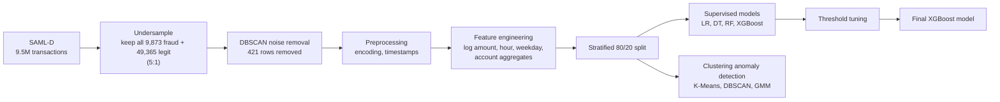
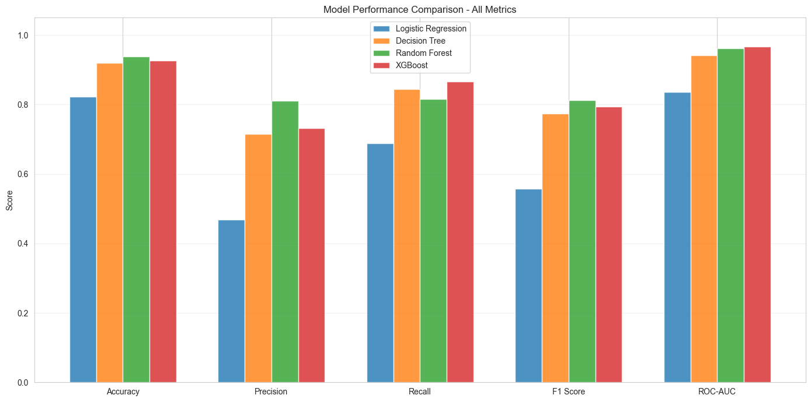
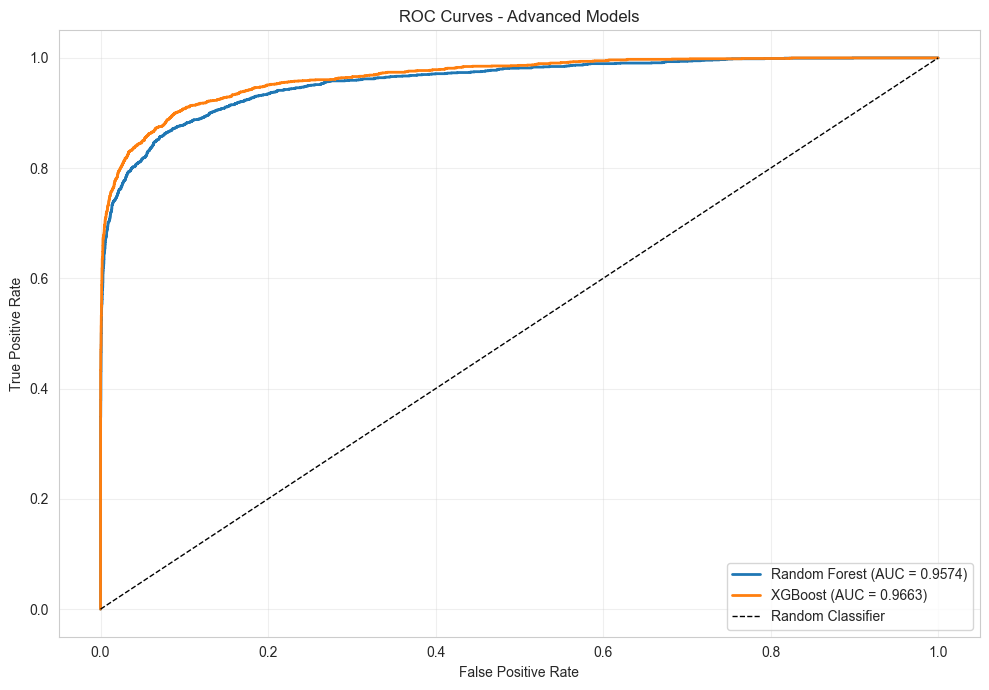
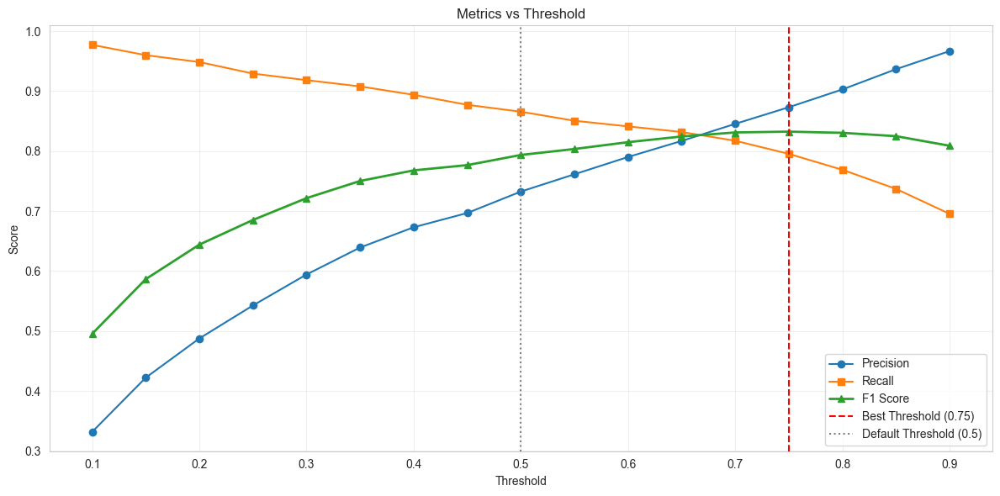
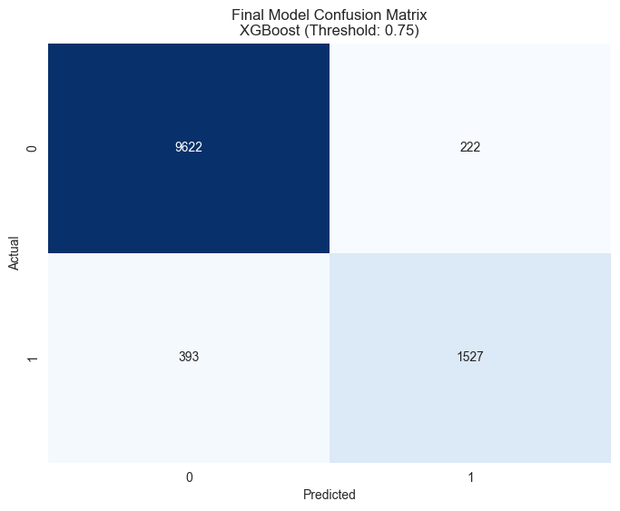
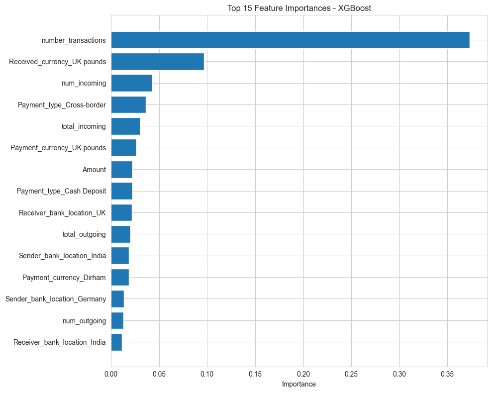

<div align="center">

# 🏦 Anti-Money Laundering (AML) Detection System

**Machine learning pipeline that flags suspicious transactions on the SAML-D dataset, comparing supervised models and clustering-based anomaly detection**

[](https://www.python.org/)
[](https://xgboost.readthedocs.io/)
[](https://scikit-learn.org/)
[](https://pandas.pydata.org/)
[](https://jupyter.org/)

</div>

---

## 📖 Table of Contents

- [Overview](#-overview)
- [Key Results](#-key-results)
- [Dataset](#-dataset)
- [Pipeline](#-pipeline)
- [Models and Results](#-models-and-results)
- [Using the Trained Model](#-using-the-trained-model)
- [Project Structure](#-project-structure)
- [Getting Started](#-getting-started)
- [Limitations and Next Steps](#-limitations-and-next-steps)
- [Team](#-team)

---

## 🔍 Overview

**Money laundering** disguises illegally obtained funds as legitimate income. Banks must monitor transactions for it, but laundering is extremely rare, so real cases are buried among millions of normal payments.

This project builds and compares several approaches on the **SAML-D** synthetic transaction dataset (9.5 million transactions, about 0.1% of them laundering):

- **Supervised learning:** Logistic Regression, Decision Tree, Random Forest, and XGBoost
- **Imbalance handling:** class weights, random under-sampling, and SMOTE
- **Unsupervised anomaly detection:** K-Means, DBSCAN, and Gaussian Mixture Models
- **Threshold tuning:** choosing the operating point that balances missed laundering against false alarms

The best model, an **XGBoost classifier**, is saved in `models/` together with its decision threshold and documentation.

---

## 🏆 Key Results

Final model: **XGBoost, decision threshold 0.75**, evaluated on a held-out 20% test set (11,764 transactions, 16.3% laundering).

| Metric | Score |
|---|---:|
| Accuracy | 94.8% |
| Precision | 87.3% |
| Recall | 79.5% |
| F1 score | 0.832 |
| ROC-AUC | 0.966 |

Of 1,920 laundering transactions in the test set, the model catches **1,527** (and misses 393), while wrongly flagging 222 of 9,844 legitimate ones.

> **Important:** these numbers come from a **rebalanced sample** where laundering is about 16% of transactions, not the real 0.1%. They are useful for comparing models, but they would not carry over to production. See [Limitations](#-limitations-and-next-steps).

---

## 📊 Dataset

**SAML-D**, the *Synthetic Transaction Monitoring Dataset for AML*, available on [Kaggle](https://www.kaggle.com/datasets/berkanoztas/synthetic-transaction-monitoring-dataset-aml).

| Property | Value |
|---|---|
| Transactions | 9,504,852 |
| Laundering transactions | 9,873 (0.10%) |
| Columns | 12 (time, date, sender and receiver account, amount, payment and received currency, sender and receiver bank location, payment type, laundering label and type) |
| Currencies / locations / payment types | 13 / 18 / 7 |
| Target | `Is_laundering` (binary) |

The dataset is **not included in this repository** because of its size. Download `SAML-D.csv` and place it in `data/raw/`.

---

## 🔄 Pipeline



1. **Exploration and balancing (`01_EDA`)**: summary statistics and plots; all 9,873 laundering transactions are kept and legitimate ones are randomly under-sampled to a 5:1 ratio (59,238 rows). K-Means (with the elbow method) and DBSCAN (with a k-distance graph) are explored, and DBSCAN noise points are removed, leaving **58,817 rows** (49,219 legitimate, 9,598 laundering).
2. **Preprocessing (`02_preprocessing`)**: drops constant and mostly-missing columns, builds a timestamp from date and time, fills missing values, and one-hot encodes low-cardinality categoricals (76 columns).
3. **Feature engineering (`03_feature_engineering`)**: adds `log_amount`, `hour`, `weekday`, and per-account aggregates (`total_outgoing`, `num_outgoing`, `total_incoming`, `num_incoming`, `number_transactions`). PCA is also explored (13 numeric features to 9 components keeps 96.7% of variance) but is not used by the final model.
4. **Modeling (`04` to `07`)**: baselines, imbalance handling, clustering-based detection, advanced models, threshold optimization, model comparison, and the final model.

Every split is a stratified 80/20 split (`random_state=42`): 47,053 training and 11,764 test transactions.

---

## 🤖 Models and Results

### Supervised model comparison

All models evaluated on the same test set at the default 0.5 threshold:

| Model | Accuracy | Precision | Recall | F1 | ROC-AUC |
|---|---:|---:|---:|---:|---:|
| Logistic Regression | 0.822 | 0.469 | 0.689 | 0.558 | 0.836 |
| Decision Tree | 0.920 | 0.715 | 0.845 | 0.774 | 0.941 |
| Random Forest | **0.939** | **0.810** | 0.816 | **0.813** | 0.963 |
| **XGBoost** | 0.926 | 0.732 | **0.866** | 0.794 | **0.966** |

<p align="center">
  
</p>

XGBoost has the highest recall and ROC-AUC, so it was selected: in AML, missing a real laundering case costs more than reviewing an extra alert.

<p align="center">
  
</p>

### Handling class imbalance (Logistic Regression)

| Technique | Precision | Recall | F1 |
|---|---:|---:|---:|
| Class weighting | 0.469 | 0.689 | 0.558 |
| Random under-sampling | 0.464 | 0.698 | 0.558 |
| SMOTE | 0.491 | 0.657 | 0.562 |

All three raise recall over a plain Logistic Regression (recall 0.37) at the cost of precision, and perform similarly. The data had already been under-sampled to 5:1 in the EDA step.

### Clustering-based anomaly detection

Unsupervised methods, which do not use labels to train, were tested as an alternative:

| Method | Precision | Recall | F1 |
|---|---:|---:|---:|
| K-Means (cluster assignment) | 0.371 | 0.297 | 0.330 |
| **K-Means (distance score)** | 0.459 | 0.682 | **0.549** |
| DBSCAN (noise points) | 0.521 | 0.178 | 0.266 |
| DBSCAN (high-fraud clusters) | 0.604 | 0.429 | 0.502 |
| GMM (cluster assignment) | 0.463 | 0.019 | 0.037 |
| GMM (optimized threshold) | 0.436 | 0.479 | 0.456 |

The best unsupervised method (K-Means distance score, F1 0.55) is clearly behind the supervised models (F1 0.79 to 0.83), as expected when labels are available. Such methods are still useful for finding unusual behavior when labels are missing.

### Threshold tuning

XGBoost outputs a probability, so the alert threshold can be moved. Raising it from 0.5 to **0.75** maximizes F1: it removes 385 false alarms at the cost of 135 additional missed cases.

| Threshold | Precision | Recall | F1 | False positives | False negatives |
|---|---:|---:|---:|---:|---:|
| 0.50 (default) | 0.732 | 0.866 | 0.794 | 607 | 258 |
| **0.75 (chosen)** | **0.873** | 0.795 | **0.832** | 222 | 393 |

<p align="center">
  
</p>

A compliance team that can review more alerts can lower the threshold to catch more cases.

### Final model

<p align="center">
  
</p>

XGBoost parameters: 100 trees, max depth 6, learning rate 0.1, and `scale_pos_weight` ≈ 5.13 (the legitimate-to-laundering ratio in the training set).

### Most important features

<p align="center">
  
</p>

The strongest signals are account activity (`number_transactions`, `num_incoming`, `total_incoming`), receiving currency, and whether the payment is cross-border.

---

## 🧪 Using the Trained Model

The trained model, its threshold, and feature list are stored in `models/`:

| File | Content |
|---|---|
| `final_model.pkl` | Trained XGBoost classifier (saved with `joblib`) |
| `optimal_threshold.txt` | Decision threshold (0.75) |
| `feature_names.txt` | The 82 input features, in the order the model expects |
| `model_metadata.json` | Metrics, confusion matrix, and parameters |
| `MODEL_DOCUMENTATION.txt` | Written rationale and recommendations |

```python
import joblib
import pandas as pd

model = joblib.load("models/final_model.pkl")
threshold = float(open("models/optimal_threshold.txt").read())
features = open("models/feature_names.txt").read().split()

# X: a DataFrame prepared with the same preprocessing and feature engineering
# as in the notebooks, with columns in the order given by `features`
proba = model.predict_proba(X[features])[:, 1]
flagged = proba >= threshold
```

The input must be processed exactly like the training data (encoding, `src/preprocessing.py`, and `src/feature_engineering.py`).

---

## 📁 Project Structure

```
Anti-Money-Laundering-AML-Detection-System/
├── notebooks/
│   ├── 01_EDA.ipynb                      # EDA, balancing, K-Means / DBSCAN exploration
│   ├── 02_preprocessing.ipynb            # Cleaning and encoding
│   ├── 03_feature_engineering.ipynb      # Feature creation and PCA
│   ├── 04_model_baseline.ipynb           # Logistic Regression, Decision Tree
│   ├── 04b_imbalance_handling.ipynb      # Class weights, under-sampling, SMOTE
│   ├── 04c_clustering_predictions.ipynb  # K-Means, DBSCAN, GMM anomaly detection
│   ├── 05_advanced_models.ipynb          # Random Forest, XGBoost
│   ├── 05b_threshold_optimization.ipynb  # Threshold tuning
│   ├── 06_model_comparison.ipynb         # Side-by-side comparison
│   └── 07_final_model.ipynb              # Final model, evaluation, saving
├── src/
│   ├── load_data.py                      # Dataset loading helpers
│   ├── preprocessing.py                  # Cleaning and encoding functions
│   └── feature_engineering.py            # Log amount, time features, account aggregates
├── models/                               # Saved model, threshold, features, documentation
├── AML_Report.pdf                    # Short project report
├── Project.pdf                       # Notebook-by-notebook walkthrough
├── requirements.txt
└── README.md
```

---

## 🚀 Getting Started

### Prerequisites

- Python 3.8 or newer
- Enough free disk space for the SAML-D CSV (9.5 million rows)

### Installation

```bash
git clone https://github.com/YoussefMohAttia/Anti-Money-Laundering-AML-Detection-System.git
cd Anti-Money-Laundering-AML-Detection-System

python -m venv venv
source venv/bin/activate        # Windows: venv\Scripts\activate
pip install -r requirements.txt
```

### Get the data

Download `SAML-D.csv` from [Kaggle](https://www.kaggle.com/datasets/berkanoztas/synthetic-transaction-monitoring-dataset-aml) and place it at `data/raw/SAML-D.csv`. The `data/` folder is git-ignored.

### Run the notebooks in order

```bash
jupyter notebook
```

Run `01_EDA` → `02_preprocessing` → `03_feature_engineering` → `04_model_baseline` → `04b_imbalance_handling` → `04c_clustering_predictions` → `05_advanced_models` → `05b_threshold_optimization` → `06_model_comparison` → `07_final_model`. Each notebook reads the files written by the previous ones into `data/raw/` and `data/processed/`. The final notebook saves the artifacts in `models/`.

---

## ⚠️ Limitations and Next Steps

Results should be read with these points in mind:

- **Rebalanced test data.** Legitimate transactions were under-sampled to 5:1 before splitting, so the test set contains about 16% laundering instead of 0.1%. Precision and accuracy would be much lower at the real base rate.
- **Aggregate features are computed after under-sampling and before the train/test split.** Account-level counts (for example `number_transactions`, the top feature) therefore describe a sample in which almost every laundering transaction was kept but only about 0.5% of legitimate ones, and they use information from the test rows. This likely inflates the scores.
- **The decision threshold was tuned on the test set**, so the final test metrics are slightly optimistic.
- **Identifier columns** (`Sender_account`, `Receiver_account`) and label-encoded date and time are used as raw numeric features.
- **DBSCAN noise removal** was applied before modeling and also removed 275 laundering transactions.
- **Synthetic data and a single random split**, with no cross-validation or time-based split.

**Next steps:** compute account features from the full data or training rows only; split by time; tune the threshold on a validation set; drop identifier columns; evaluate with precision-recall metrics on the full, un-balanced data; add explainability (for example SHAP); and build an API and monitoring dashboard for real-time scoring.

---

## 👥 Team

| Name |
|---|
| Mazen Elsayed |
| Youssef Mohamed Attia |
| Karim Mohamed |
| Youssef Gaber |

